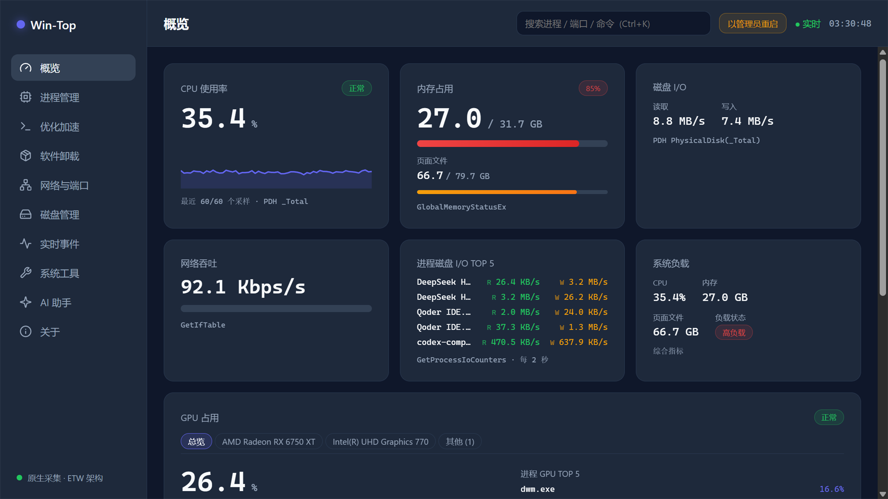
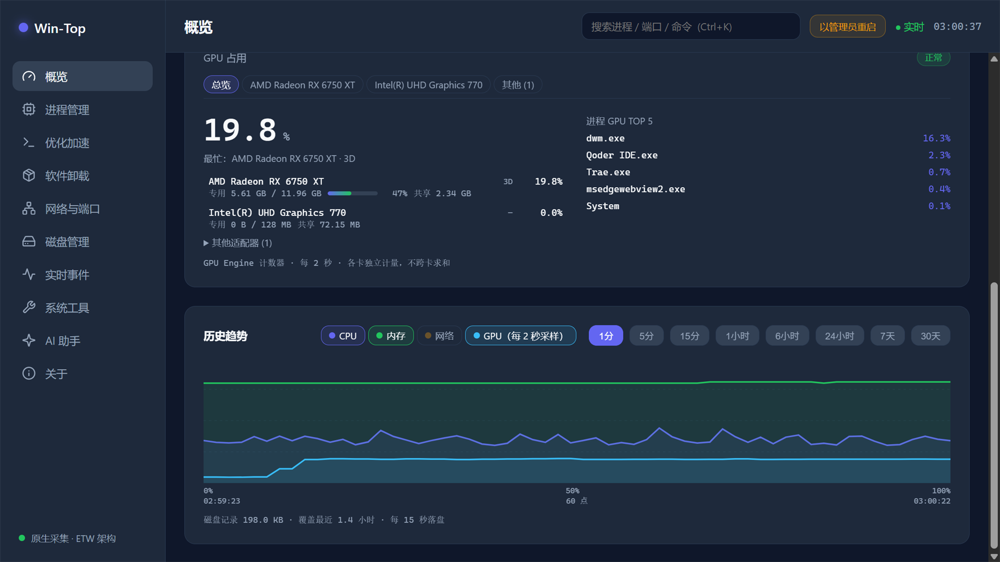
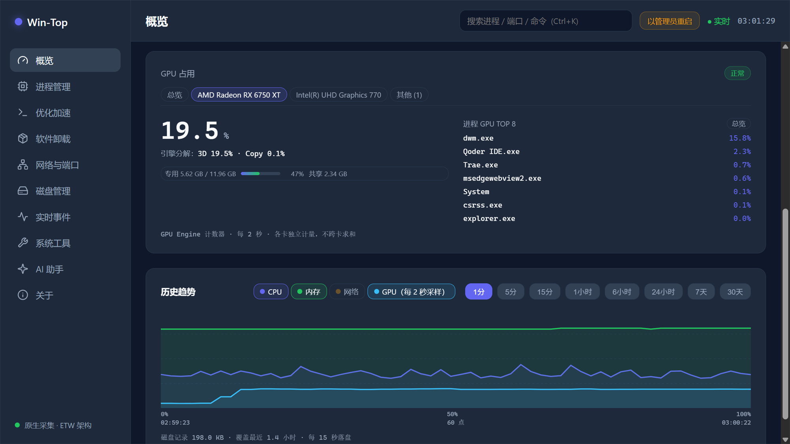
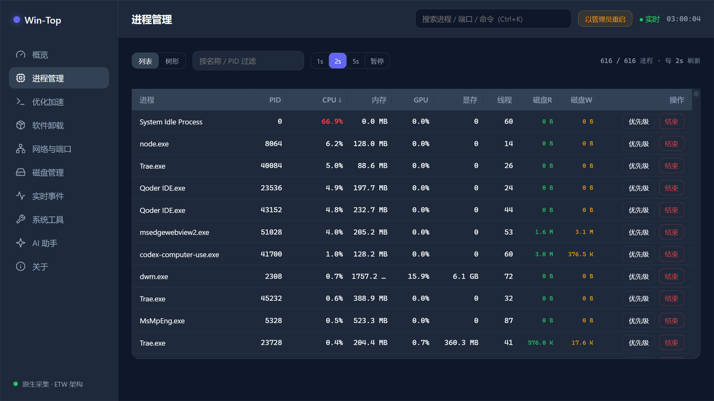

# Win-Top


**Win-Top 是一款 Windows 系统监控与资源管理工具。** 它把平时要开一堆工具才能看清的东西——进程与 GPU 占用、端口占用、磁盘空间、网络吞吐、开机启动项——收进一个桌面工作台，并提供 AI 辅助判断。

所有**监控数据**都**直调 Windows 原生接口**（PDH 性能计数器 / ETW / WMI / WinAPI）采集，进程与端口信息不通过 `netstat`、`tasklist` 之类的命令行工具获取；默认普通权限运行即可用，只有 ETW 实时事件与磁盘温度需要管理员。

> 适用场景：任务管理器看不够细的时候（**每进程 GPU 占用与显存**、端口到底被谁占着、磁盘空间去哪了、开机为什么变慢）；也适合作为一台 Windows 机器的常驻健康看板。



---

## 功能一览

### 概览与实时监控
- CPU / 内存与页面文件 / 磁盘 I/O / 网络吞吐 / 系统负载五张实时卡片，1 秒推送一次，前端不做轮询；
- 每进程磁盘 I/O TOP 5 与 GPU 卡片同屏；
- 历史趋势图：CPU / 内存 / 网络 / GPU 四系列可开关、hover 查看数值、数据缺口断线而不画成 0；停留在概览页时按档位自动刷新（1 小时内 5 秒一次，更长窗口 60 秒一次）；
- 时间窗 1 分 / 5 分 / 15 分 / 1 小时 / 6 小时 / 24 小时 / 7 天 / 30 天；1 小时内走内存热数据，更长窗口读磁盘记录并抽稀；
- 图表下方标出磁盘记录目录、占用体积、覆盖时长与落盘周期；落盘不可用时明确显示降级原因。

### 进程与性能
- 全量进程列表与树形双视图；按名称或 PID 过滤；
- 可排序列：CPU / 内存 / GPU / 显存 / 线程 / 磁盘读写；
- 刷新间隔 1s / 2s / 5s / 暂停，查看详情时自动冻结，避免行跳位；
- 列宽可拖拽、双击复位、键盘微调，宽度本地记忆；
- 详情面板：命令行、完整路径、父进程、句柄数、优先级，以及 GPU 占用、引擎分解与逐卡显存明细；
- 行内结束进程或改优先级（6 档），均有二次确认。

### 实时事件
- 基于 ETW（`Microsoft-Windows-Kernel-Process`）的进程启动 / 退出实时流，前端按 250 ms 批量合并渲染，缓冲上限 200 条；
- 全部 / 启动 / 结束三态过滤 + 按进程名过滤 + 暂停（冻结当前列表）/ 继续；
- 未提权时给出后端原因与「以管理员重启」引导（该页需管理员权限）。

### GPU 监控
- 直接读 Windows 的 `(进程, 显卡, 引擎)` 性能计数器，做到任务管理器之外的粒度；每进程 GPU 取「最忙引擎」口径，显存专用 / 共享分列；
- 概览 GPU 卡片：一张总览 + 每张硬件显卡一个 Tab + 「其他」Tab；单卡 Tab 给出该卡占用、引擎分解、显存，以及该卡自己的进程 TOP 8；
- 口径说明与实现细节见下方「GPU 监控」一节。

### 网络与端口
- 端口连接表：端口 / 协议与地址族 / 状态 / 进程 / PID / 远端地址，支持按端口、进程、PID、远端搜索，TCP·UDP 与 v4·v6 过滤、「仅监听」筛选，常用端口标记；
- 一键网络体检：网关与国内 / 海外目标并行延迟、公网 IP、DNS 解析耗时、本机网卡与网关；
- 任意「域名 / IP[:端口]」连通性检测；下行测速（多路并发，含国内镜像兜底）；
- 结束占用端口的进程：确认前自动分析同端口的其它绑定，区分同进程与其它进程，避免误杀；
- 每进程实时上下行与累计流量（ETW，需管理员）。

### 磁盘与存储
- 分区使用率、文件系统与驱动器类型；物理磁盘健康（SMART 预测语义）与温度（需管理员，多为 NVMe 支持）；
- 整卷空间分析：优先直读 NTFS MFT，百万级文件数秒完成；非管理员或非 NTFS 自动回退逐目录扫描，界面标注实际使用的扫描方式；
- 目录分布 TOP 20 与最大文件排行，支持逐级下钻、面包屑返回、在资源管理器中打开或定位；
- 扫描过程可随时取消，返回取消前已收集到的部分结果并明确提示。

### 优化与清理
- 一键加速：垃圾扫描 → 清理 → 内存释放串联执行，完成后报告释放的磁盘与内存；
- 系统体检：0–100 评分 + 问题清单 + 建议，一键优化后自动复检；
- 垃圾清理 **13 类**：用户 / 系统临时文件、回收站、缩略图缓存、Windows Update 缓存、Prefetch、Edge / Chrome / IE 缓存、最近文档、DNS 缓存、字体缓存、传递优化文件；需管理员的分类在未提权时锁定；
- 清理前可选择创建系统还原点；
- 内存释放：裁剪进程工作集，报告释放量与裁剪进程数；
- 开机启动项：Run 键与启动文件夹枚举、启用态判定、开关式启停（写 StartupApproved，可逆，不删原项；HKLM 项需管理员）。

### 软件卸载
- 已装软件清单（注册表三处 Uninstall 键，过滤系统组件与更新补丁）；
- 推荐卸载度 0–100，附可解释理由：多久没用过、是否开机自启却很少使用、占用磁盘多少；疑似安全 / 驱动 / 系统组件会标注「谨慎」并封顶分数；分数只用于排序，不会自动勾选；
- 卸载前解析产物足迹：安装目录、残留目录、残留注册表键、关联服务与启动项，每项带分类与置信度；
- 卸载流程：能力探测（交互 / 静默）→ 确认 → 运行厂商卸载器或 `msiexec` → 轮询确认卸载完成 → 复扫残留 → 勾选清理；
- 残留清理可撤销：文件与目录移入隔离区，注册表键先导出备份；含用户数据时必须手动确认才能清理。

### 系统工具
- 防火墙规则查看与开关（需管理员，操作前确认）；
- 系统还原点列表与创建；
- 文件占用解锁：按路径查找占用进程并结束；
- 导出报告：系统快照 JSON（进程 + 端口 + 磁盘 + 启动项）与进程列表 CSV，写到桌面。

### 版本与更新
- 侧边栏底部常驻当前版本，点击可检查 GitHub 最新正式版本（启动后静默检查一次，失败不打扰）；
- **支持应用内自动更新**：安装版（NSIS / MSI）下载对应安装包后静默安装并自动重启；便携版下载新版 exe 后原地替换并重启（不写入系统目录）；MSI per-machine 更新会请求一次 UAC 确认；
- 下载后校验 GitHub 资产 `sha256` 摘要与文件魔数，失败即中止；只访问 GitHub 公开版本信息与官方 Release 资产，不静默提权、不上传任何本机数据；
- 未引入代码签名 / minisign 验签：更新完整性依赖 GitHub HTTPS 与资产摘要，与手动下载同源（见待做）。

### AI 助手
- 内置 8 家 OpenAI 兼容厂商（OpenAI / DeepSeek / 月之暗面 / 阿里通义 / 智谱 / 硅基流动 / OpenRouter / 本地 Ollama），也可填自定义接口与模型；
- 每次提问自动附带当前系统快照（CPU / 内存 / 磁盘 / 网络 / 进程 TOP / 分区占用），基于实测数据回答；
- 提示词要求优先引导使用软件内已有功能，并按菜单路径说明操作方式；涉及结束进程、清理、改防火墙等风险操作会提示风险；
- 流式输出可中止，对话内容按 Markdown 渲染；
- 说明：调用的是外部 OpenAI 兼容接口，**不是本地模型**；AI 只看到上述快照，不能读取实时数据、不能执行命令或脚本；接口密钥保存在本机 localStorage。

> 全部 9 张截图见 [`docs/screenshots/`](docs/screenshots/)。

---

## GPU 监控（v0.1.6 新增）

Windows 的 GPU 性能计数器按 **(进程, 显卡, 引擎)** 暴露实例，Win-Top 直接读这套数据，因此能做到任务管理器之外的粒度：



- **每进程 GPU 占用**：取「最忙引擎」口径（与任务管理器一致），并可展开看该进程在各张卡上的分解；
- **每进程显存**：专用 / 共享分列，支持排序；
- **概览 GPU 卡片**：一张总览 + 每张独立显卡一个 Tab，含各卡占用、引擎分解、专用/共享显存、该卡自己的进程 TOP 8；
- **历史趋势**：GPU 曲线与 CPU / 内存 / 网络并列，时间窗 1 分 ~ 30 天。

单卡 Tab 给出该卡自己的占用、引擎分解、专用 / 共享显存，以及该卡的进程 TOP 8：



「进程管理」中 GPU 与显存是独立的可排序列，详情面板给出该进程的逐卡分解：



采集口径上有一处**必须说明**的地方：各进程的「专用显存」**不能相加**当作显卡占用。跨进程共享的画面显存会被同时记在每个持有它的进程名下——本机实测各进程相加 10.24 GiB，而显卡自身只报 5.02 GiB（`dwm.exe` 单个进程就报 5.72 GiB，比整卡还多）。显卡级占用一律读 `\GPU Adapter Memory(*)`，进程级才读 `\GPU Process Memory(*)`。

---

## 历史趋势持久化（v0.1.6 新增）

历史数据不再只活在内存里，会以定长追加的方式落到本地磁盘：

- **位置**：`%LOCALAPPDATA%\WinTop\history\`；若 exe 同级存在 `wintop.portable` 标记文件则改为 `<exe 同级>\WinTop-data\history\`（发行的便携版 exe 默认不带该标记，因此默认仍写 `%LOCALAPPDATA%`；需要自包含时手动创建空文件 `wintop.portable`）；
- **格式**：自研定长记录（64 B/条，逐条 CRC32），按小时/天分段，**不引入 SQLite 等任何新依赖**；
- **写入**：每 15 秒批量落盘，正常使用对磁盘的压力是"每天秒级 I/O"；
- **保留**：原始 1 秒 × 7 天 → 1 分钟聚合 × 90 天，**硬上限 200 MiB**，超出按最旧段淘汰；
- **GPU 历史**：只保存最忙引擎的标量（单条曲线），逐卡明细仅在实时视图可见；
- **降级**：目录不可写、磁盘空间不足、已有实例占用时自动退回纯内存模式，不影响其它功能。

---

## 技术栈与架构

**技术栈**：Tauri 1.x · Rust · Svelte 4 · Vite

```
┌──────────────────────────────┐
│          UI Frontend          │
│       Svelte 4 + Vite         │
└─────────────┬────────────────┘
              │ Tauri Bridge（事件推送 + 命令调用）
┌─────────────▼────────────────┐
│        Rust Core Service      │
│  系统采集 / 系统操作 / 权限控制 │
└─────────────┬────────────────┘
              │ Windows APIs
┌─────────────▼────────────────┐
│   PDH / ETW / WMI / WinAPI    │
└──────────────────────────────┘
```

**监控数据采集**——全部直调 Windows 原生接口，不派生 `netstat` / `tasklist` 之类的外部命令：

| 能力 | 实现 |
| --- | --- |
| CPU / 磁盘 I/O | PDH 性能计数器 |
| 内存 | `GlobalMemoryStatusEx` |
| 进程枚举 | `NtQuerySystemInformation` |
| 进程操作 | `OpenProcess` / `TerminateProcess` / `SetPriorityClass` |
| **每进程 GPU 占用 / 显存** | **PDH `GPU Engine` / `GPU Process Memory` / `GPU Adapter Memory`** |
| **显卡名称与容量** | **DXGI `EnumAdapters1` + `DXGI_ADAPTER_DESC1`** |
| 端口连接 | `GetExtendedTcpTable` / `GetExtendedUdpTable` |
| 进程事件 / 每进程流量 | ETW（Kernel-Process / Kernel-Network） |
| SMART / 磁盘温度 | WMI |
| 空间分析 | NTFS MFT 直读 |
| 历史持久化 | 自研定长追加文件（无第三方存储依赖） |
| **应用更新** | **GitHub Releases API + 自研下载/安装器（SHA-256 摘要 + 文件魔数校验；无签名密钥，便携版原地替换、NSIS/MSI 静默安装）** |

> **关于子进程**：上面这条只覆盖**监控采集**路径。系统工具类操作走的是另一条路径——防火墙用 `netsh`、系统还原 / 服务管理 / 文件解锁用 PowerShell、软件卸载用厂商卸载器或 `msiexec` / `reg.exe`、DNS 缓存清理用 `ipconfig`。这些都是系统自带组件，但确实会派生子进程，此处如实说明。

**采集模型**：后端常驻采集线程分层采样（指标 1s、进程 2s、GPU 2s、磁盘 15s、事件实时），通过事件推送到前端，避免高频轮询。

**权限模型**：默认普通权限运行，核心功能全部可用；ETW 实时事件、磁盘温度需要管理员权限，应用内提供「以管理员重启」一键提权；结束进程、清理磁盘、防火墙变更等风险操作均有确认与提示。

---

## 安装

从 [Releases](https://github.com/nickshui/Win-Top/releases) 下载：

| 文件 | 说明 |
| --- | --- |
| `Win-Top_x.y.z_portable_x64.exe` | 绿色便携版，免安装，下载后双击即用（推荐快速体验） |
| `Win-Top_x.y.z_x64-setup.exe` | NSIS 安装包，推荐 |
| `Win-Top_x.y.z_x64_en-US.msi` | MSI 安装包 |

**系统要求**：Windows 10 1809+ / Windows 11，x64；依赖 WebView2 运行时（Windows 11 自带；使用安装包时若缺失会自动引导安装）。

> - 便携版不含 WebView2 引导：极少数未预装 WebView2 的系统（多为精简版 Windows 10）需先安装 [WebView2 运行时](https://developer.microsoft.com/zh-cn/microsoft-edge/webview2/)，再运行便携版。
> - 安装包与便携版均暂未做代码签名，SmartScreen 可能提示「未知发布者」，选择「仍要运行」即可。

## 本地构建与启动

依赖：Node.js 18+、Rust stable（MSVC 工具链）。

```bash
npm install
npm run tauri dev     # 开发调试（Vite 热更新 + Rust 后端）
npm run tauri build   # 构建安装包，产物在 src-tauri/target/release/bundle/
```

发版流程见 [`docs/release-process.md`](docs/release-process.md)。

---

## 待做任务

按「用户可感知的价值」排序。**现状**列区分三种情况：完全没做 / 部分实现（缺什么写在说明里）/ 后端已实现但界面还没有入口。

| 待做 | 现状 | 说明 |
| --- | --- | --- |
| 服务管理界面 | 后端已实现 | 服务列表、启动类型切换与一键还原的后端命令齐全，界面尚无入口 |
| 端口远端 IP 归属地 | 后端已实现 | Geo-IP 查询命令已实现（含本地缓存），端口表未接入 |
| 定时清理与高占用告警 | 部分实现 | 后端调度器仅按间隔扫描并发通知，不自动清理、间隔不可配置、重启失效；阈值告警未做 |
| 命令与脚本工具箱 | 完全没做 | 常用命令卡片化、参数可视化、风险说明、执行日志留存与导出 |
| Ctrl+K 命令面板 | 部分实现 | 顶部已有占位输入框，但无搜索逻辑与快捷键处理 |
| 进程签名与操作日志 | 完全没做 | 进程可执行文件签名状态；结束进程 / 清理 / 防火墙等操作的日志与导出 |
| 卸载足迹补全 | 部分实现 | 计划任务与防火墙关联产物未覆盖，安装目录外仅做已知根目录探测 |
| 卸载时清理服务与启动项 | 部分实现 | 当前只展示，不自动删除 |
| AI 脚本生成与执行确认 | 完全没做 | 生成脚本草案 → 显示完整命令与风险 → 人工确认后执行 |
| 从端口生成防火墙规则、一键复制 | 完全没做 | 端口行直接生成规则；复制连接信息（当前无剪贴板能力） |
| 磁盘页清理建议 | 部分实现 | 已有最大文件与目录分布，缺「可清理什么、预计释放多少、风险是什么」 |
| 概览仪表盘增强 | 完全没做 | 模块聚合的 Bento 布局 |
| GPU 历史逐卡明细 | 部分实现 | 历史只存最忙引擎标量，逐卡明细仅实时可见 |
| 进程视图数据覆盖度 | 部分实现 | 磁盘读写列只有 TOP 15 进程；未上榜进程显示 0 |
| 非管理员整卷扫描 | 部分实现 | MFT 需管理员；回退的逐目录扫描深度上限 8 层，深目录会低估 |
| 文件解锁原生实现 | 部分实现 | 现走 PowerShell 模块匹配，计划改用 Restart Manager |
| 服务改动与清理间隔持久化 | 部分实现 | 服务原值存内存、调度器重启失效 |
| 未接入界面的后端能力 | 后端已实现 | 后台进程建议、视觉效果预设（最佳性能 / 外观 + 还原）尚无入口 |
| 应用内自动更新 | 基本完成 | 检查 + 下载 + 自动安装/重启已打通（便携版原地替换、NSIS/MSI 静默安装，SHA-256 校验）；未做代码签名 / minisign 验签与回滚 |
| CSP 硬化与代码签名 | 完全没做 | 当前未启用 CSP、Tauri allowlist 全开、安装包无签名 |
| 浅色主题与多语言 | 完全没做 | 目前仅深色主题、界面文案仅中文 |
| 远程管理与多设备监控 | 完全没做 | 需要网络服务端与账号体系 |
| 插件生态与脚本分享 | 完全没做 | — |

## 设计原则

- **安全第一**：危险操作必须二次确认。
- **可解释性**：执行前说明原因、风险、后果。
- **不夸大**：不做「一键提速 300%」这类无法验证的承诺；口径说不清的数字，宁可不显示。
- **可追溯性**：所有操作可查看日志与回滚建议。
- **扩展性**：以插件与脚本体系持续演进。

## 项目愿景

Win-Top 的目标是成为 Windows 平台上专业、智能、可扩展的资源管理与系统维护工具。它不仅是一款监控工具，更是一个"系统专家"，帮助用户理解电脑、管理电脑、优化电脑。

---

## English

**Win-Top is a Windows system monitor and resource manager** built with Tauri, Rust and Svelte.

It unifies process management (**including per-process GPU usage and VRAM**), port-to-process mapping, disk space analysis, network throughput, startup-item control, app uninstalling and AI-assisted diagnosis into one desktop workbench. All monitoring data is collected straight from native Windows APIs (PDH / ETW / WMI / WinAPI) — **process and port data never come from shelling out to `netstat` or `tasklist`** — and it runs unelevated by default. (System-tool actions such as firewall rules, restore points, file unlocking and uninstalling do invoke built-in `netsh` / PowerShell / vendor uninstallers.)

Highlights: per-process GPU utilization and dedicated/shared VRAM, a per-adapter GPU card, history trends persisted to disk (1 s raw for 7 days, 1 min rollups for 90 days, 200 MiB hard cap), NTFS MFT based whole-volume space analysis, ETW-driven real-time process and per-process network events, and in-app updates (check + one-click install: portable in-place replace, NSIS/MSI silent install; SHA-256 verified, no signing keys).

Requirements: Windows 10 1809+ / Windows 11, x64, WebView2 runtime. See [Releases](https://github.com/nickshui/Win-Top/releases).
